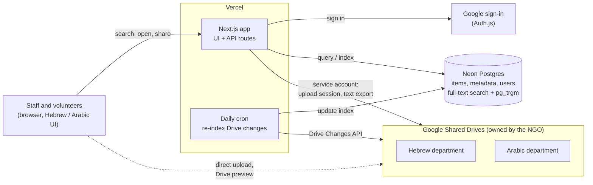

# Ladaat – Shared Knowledge Base

A bilingual (Hebrew and Arabic) knowledge base for the staff and volunteers of [Ladaat](https://ladaat.org.il/). Today the Hebrew and Arabic departments work side by side, and knowledge moves between them mostly by word of mouth. This app gives both departments one place to find contacts, pregnancy-termination committees, medical services, rights and documents, while each department keeps managing its own content.

The main flow is home/search → open an item (in Hebrew or Arabic) → share it.

Built in Digital Product Jam (HUJI × Bezalel, 2026-27).

## Architecture

- **App:** Next.js on Vercel, serving the UI, the API routes and a daily cron job.
- **Files:** stored in the NGO's Google Shared Drives, one per department. The app uploads and indexes them through a service account, and users view them with the Drive preview.
- **Database and search:** Neon Postgres holds the items, metadata, users and links between the Hebrew and Arabic versions of each item. Search uses Postgres full-text search with `pg_trgm` to handle typos, and Hebrew and Arabic text is normalized the same way at indexing and at query time.
- **Tagging:** suggested automatically when a file is indexed, and the user only confirms or removes them. Tags come from a fixed bilingual list with synonyms, matched against the normalized title and text. The region comes from a list of places. The category is suggested from the Drive folder, the matched tags and the most similar existing items. No document text leaves the system.
- **Auth:** Google sign-in with Auth.js, open only to organization staff. The roles are viewer, department editor and admin.
- **AI:** none in the first version. Local embeddings (`pgvector`) or an LLM could improve tagging later, and an LLM needs the NGO's approval because document text would leave the system.

All accounts belong to the NGO, and the estimated cost is 0–10 ₪ a month.
